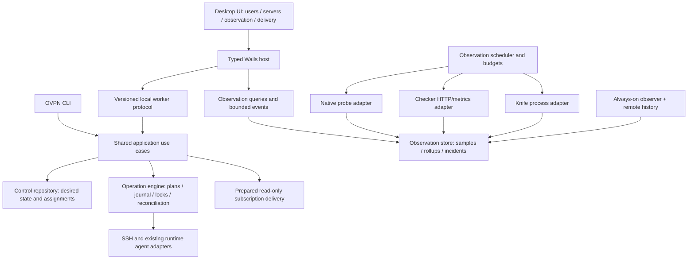

# OVPN Desk: complete application plan

Status: target product and architecture. The current build has live read-only server/user inventory and manual native HTTPS checks. Monitoring, integration setup and reviewed writes shown in the new screens are design previews. English remains the default; Russian is selected in Settings.

## Product boundary

OVPN Desk is a desktop operations console for a self-hosted Xray fleet: users, access delivery, server lifecycle, observation and recovery belong to one workspace. Start with one operator, then add explicitly scoped collaboration. Keep control state local and management over SSH; a public management panel is not a prerequisite. A device-wide VPN client, privileged TUN routing and commercial billing are separate products/milestones.

The first development slice exposed only summary/server/check queries. Its missing user list was an implementation gap: the CLI already creates, disables, removes, expires and quotas users. The desktop now exposes policy inventory and the latest explicitly requested per-user/path observation, but writing through those Cobra handlers would bypass the proposed operation journal and still produce human-oriented, potentially sensitive errors. Extract the use cases before enabling live buttons.

## Primary workspaces

| Area | Information and interaction | Completion evidence |
| --- | --- | --- |
| Overview | Active incidents, affected users/nodes, runtime versus traffic, observation freshness, quota pressure, recent changes and next useful action | Each number links to its scope/filter; unknown measurements never become green. |
| Users | Search/filter, access policy, configured assignments, quota per server, rolling-window usage with timestamp, expiry, delivery state, reconciliation, recent activity and individual traffic evidence | Operator can see why access is allowed/blocked and which nodes have applied the intended state. |
| User detail | Overview, assignments/profiles, traffic/quotas, delivery, observations and change history | Issue → publish → verify; disable → per-node reconcile; rotate delivery separately from VPN credentials. |
| Servers | Agent/Xray/SSH observations, versions, profiles/listeners, desired/applied revision, capacity, certificate expiry, user/traffic pressure and recent faults | Add/import → trust host → review plan → apply → verify a new connection. |
| Server detail | Health, users, profiles, routes, quota/stat freshness, changes, backups and bounded redacted logs | A working management connection cannot substitute for client-path evidence. |
| Monitoring | Observation sources, node/profile matrix, named targets, success ratio, TTFB/handshake where measured, gaps, budgets, schedules and incidents | A source outage, a failed target and an unsupported measurement remain distinguishable. |
| Incidents | Dedupe key, first/last seen, affected scope, evidence timeline, acknowledgements and resolution conditions | A failing sample may open a suspect state; confirmed thresholds open an incident; recovery requires fresh evidence. |
| Subscriptions | Owners, snapshot generation, publication freshness, delivery health, change preview, token rotation/revocation and client format | Same URL updates after publication; old download token refusal and VPN identity refusal are tested separately. |
| Integrations / Lab | Native, Checker and Knife adapters, versions, capability status, permissions, test budgets, job history and comparison results | A provider result is attributable to an engine/version/source/target, with credential-free UI data. |
| Changes & recovery | Durable plans, scope, checkpoints, per-node outcomes, snapshots, reconciliation, staged rollout and restore rehearsal | A crash cannot silently repeat a write; a rollback/restore needs a fresh connection check. |
| Settings | Workspace, language/theme, host trust, credential storage, observation policies, budgets, retention, notifications and update channels | Settings describe actual effects, including whether monitoring survives application shutdown. |

Place Users next to Overview, with server/user detail panels linked both ways. Overview should emphasize incidents and useful counters over decorative cards. Keep bulk actions above filtered selections and show the captured target set before execution. Large tables require server-side search/filter/paging; the current search is explicitly limited to loaded user rows.

## User lifecycle is the first write milestone

Required operations: create, enable/disable, expiry set/clear, rolling quota set/reset, publish/refresh/rotate/revoke delivery, explicit credential rotation and final removal. Show the difference between suspension and deletion. Preserve unrelated user fields and accumulated traffic during changes.

Today's user lifecycle targets **all enabled servers**, and quotas are per-server rolling 30-day policies, not one global calendar-month allowance. The UI must state this. Planned node groups require backend assignments, migration rules and tests; adding a group selector alone is insufficient.

A user has independent facets:

| Facet | Meaning | Example UI |
| --- | --- | --- |
| Desired policy | Enabled, expiry, quota policy and local quota-block state | Allowed / expired / disabled / quota blocked. |
| Distribution | Which target nodes have observed the intended identity/revision | Applied 3/4; one node unreachable. |
| Traffic | An explicitly selected identity/profile passed from a named source | Verified from observer-a, 45 s ago. |
| Activity | Recent usage or session evidence, with collection method and expiry | Traffic observed in the last 5 minutes. |
| Delivery | Current prepared snapshot and URL lifecycle | Published generation 12 / needs publication / revoked. |

A dedicated probe identity proves the selected node/profile path, not every customer's credentials. Do not mark every user online or individually verified from a single probe. Quota resets, suspensions and identity rotations have distinct effects and verification criteria. Existing sessions may survive credential revocation; do not promise immediate termination without a demonstrated runtime mechanism.

Revocation verification needs a separate use case: the normal probe rejects locally disabled/removed users before attempting traffic. Preserve a narrowly scoped pre-change client reference in protected operation storage, test a fresh connection with the old credential, and compare with a positive control on the same node/profile plus runtime reconciliation. A local policy rejection or generic network failure alone is not evidence that the remote credential was revoked. Expire and erase the prepared credential after verification/recovery.

## Application architecture

Separate desired control state from observation data, transient jobs and user preferences. Continue using the existing control database; an observation database/retention mechanism is additional. Raw results must not store credentials. Refreshing a table queries local projections, not every remote host.

Core modules and responsibilities:

| Module | Responsibility |
| --- | --- |
| `internal/app` | Users, servers, delivery and diagnostic use cases; shared with CLI; typed errors. |
| `internal/operations` (planned) | Stored plan/revision preconditions, stable target set, cross-process/remote host locks, snapshots, journal and uncertain-state reconciliation. |
| `internal/observation` (planned) | Normalized samples, provenance, freshness, incident policy, retention and query projections. |
| `internal/scheduler` (planned) | Bounded jobs, jitter, deadlines, cancellation, scope capture and traffic budgets. |
| `internal/integrations` (planned) | First-party Native/Checker/Knife adapters, version/capability checks and private artifacts. |
| Native host | Worker ownership, OS credentials, trusted paths, notifications and lifecycle. |
| Frontend | Keyed localization, screens, interaction state and view models; no shell, SQL or secret storage. |

Add stable logical user/assignment IDs before group management. Existing records are per-node and currently grouped by username for read-only inventory. A migration must detect identity conflicts and preserve UUIDs, quotas and disabled/expired state. A scoped monitoring identity needs its own lifecycle rather than an invisible global `user add`.

The current sequential protocol 1 gains additive read-only queries such as `users.list`. A future operation/event protocol needs an explicit compatibility decision, request cancellation, subscription cursors and replay. Never advertise unfinished operations in the handshake. Enforce plan scope in Go; disabled frontend buttons are not an authorization boundary.

## Dependency-ordered delivery

| Increment | Useful result | Required gate |
| --- | --- | --- |
| 0. Visibility — implemented here | Live Users inventory, policy conflicts/limits, brighter semantic statuses and product workflow previews | Read-only projection, pagination, secret exclusion and no fabricated per-user connectivity. |
| 1. Access lifecycle | Create/disable/expiry/quota changes from desktop, followed by delivery | Shared typed use cases, durable plan/journal, locked target set, partial failures and crash reconciliation. |
| 2. Scheduled observation | Explicit policy setup, native schedule, Checker ingestion and incident history | Scoped monitoring identities, one schedule owner, budgets, freshness, background lifecycle and source separation. |
| 3. Diagnostic laboratory | Knife batch/core comparison, opt-in resource checks and speed tests | Pinned tested binary/schema, isolated job data, no raw links in UI/logs and bounded egress/traffic. |
| 4. Fleet operations | Server setup/update/replacement, scoped groups and staged changes | Assignment migration, revision/digest preconditions, backup and per-node postconditions. |
| 5. Recovery and distribution | Fresh-workspace restore drill and supported native releases | Independent recovery key, native OS/SSH/vault/accessibility tests, signing/notarization and updater rollback. |

Deliver a usable vertical journey in each increment. The next implementation should make **create user → review all enabled nodes → apply → per-node outcome → publish delivery** real, before adding secondary transports or decorative controls.

## Release acceptance

- Existing and new users appear without loading private server keys or exporting UUIDs/contact details.
- Two desktop/CLI writers cannot overwrite one another; an unreachable node leaves a visible partial outcome.
- A customer with expired or quota-blocked policy is not made to look connected by a healthy service probe.
- Closing/sleeping the desktop expires local observations; always-on history is available only with an actual remote collector/history store.
- A leaked delivery URL and a revoked VPN identity have separate, reproducible tests.
- Quota and traffic displays state node/window/freshness; missing counters remain unknown rather than zero.
- Keyboard navigation, long Russian labels, light/dark contrast and 1024×720 windows are checked on native targets.

## Reference analysis

Reviewed pinned source snapshots, rather than assuming current main equals every public release:

- [CELERITY users](https://github.com/ClickDevTech/CELERITY-panel/blob/f8f7da58d2f0bb21fd8f0bb31a533bdbfc98ea6f/views/users.ejs), [user detail](https://github.com/ClickDevTech/CELERITY-panel/blob/f8f7da58d2f0bb21fd8f0bb31a533bdbfc98ea6f/views/user-detail.ejs), [dashboard](https://github.com/ClickDevTech/CELERITY-panel/blob/f8f7da58d2f0bb21fd8f0bb31a533bdbfc98ea6f/views/dashboard.ejs): actionable tables, group assignment, quota/traffic context and linked detail views are strong product patterns.
- [CELERITY probes](https://github.com/ClickDevTech/CELERITY-panel/blob/f8f7da58d2f0bb21fd8f0bb31a533bdbfc98ea6f/docs/probes.md): dedicated identities, per-source histories, budgets, missing-sample gaps and local-core failure separation are useful operational patterns. These capabilities already exist there; OVPN must prove its own implementation.
- [Checker configuration](https://github.com/kutovoys/xray-checker/blob/f829c2b7d44670f4db0f7355f445771e7cde7158/config/config.go) and [API](https://github.com/kutovoys/xray-checker/blob/f829c2b7d44670f4db0f7355f445771e7cde7158/web/openapi.yaml).
- [Knife HTTP command](https://github.com/lilendian0x00/xray-knife/blob/a579d42d2ca2b40293c20db0353d39ad4495066b/cmd/http/http.go) and [result fields](https://github.com/lilendian0x00/xray-knife/blob/a579d42d2ca2b40293c20db0353d39ad4495066b/pkg/http/examiner.go).

The visual work is original. Borrow workflow principles and information hierarchy, not third-party code/assets or unsupported claims of superiority.
