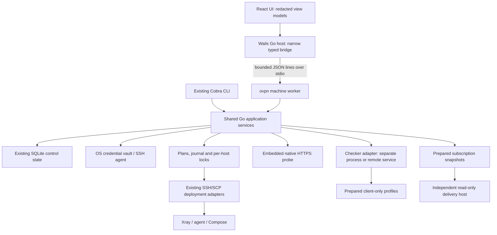

# Desktop architecture

Status: design reference. The current [operator guide](../../desktop.md)
describes Desk 1.13: typed worker methods, operation plans/journal, writer locks,
Checker/Knife supervision, telemetry and HA-aware application are implemented.
Some sections below remain target design, including OS vault integration and
tray/service lifetime. Registered Cobra callbacks remain composition adapters;
extracting their remaining domain logic is still in progress. Native platform
acceptance and the usability pilot remain release gates.

## 1. Runtime choice

Choose **Wails 3 + React + TypeScript**, with a native Go host and the existing OVPN executable as a typed local worker. Evaluate stable `v3.1.0` in the platform spike; do not track nightly builds. Development macOS and Windows binaries are built; full native acceptance on every target remains open.

[Wails v3.1.0](https://github.com/wailsapp/wails/releases/tag/v3.1.0) provides a current desktop baseline. Its [installation requirements](https://v3.wails.io/quick-start/installation/) include platform WebViews and native build dependencies. Do not turn vendor size or memory comparisons into OVPN performance claims: embedded Xray changes the application's footprint.

| Candidate | Assessment for this project |
| --- | --- |
| Wails 3 | Preferred: Go host, typed frontend bindings and native WebViews fit the current engine. Gate adoption on packaging, SSH, accessibility and bridge security tests on all targets. |
| Wails 2 | Maintenance fallback to evaluate if older GTK requirements become essential. Reuse the worker contract; do not assume legacy support without native tests. |
| Tauri 2 | Viable fallback; its [prerequisites](https://v2.tauri.app/start/prerequisites/) add Rust. Keep the same worker contract if a platform blocker makes this worthwhile. |
| Electron | Viable if WebView consistency dominates the decision. It adds a Chromium/Node distribution and a larger update surface; benchmark the actual product before selecting it. |

Use the stable native backend initially. Experimental rendering backends and mobile targets are outside the first release.

## 2. Boundaries



The UI never opens SQLite, runs a shell or constructs deployment scripts. Do not import `internal/cli.App` into a GUI or parse its human-readable stdout. Extract its orchestration into `internal/app`; Cobra and the new machine worker use the same implementations. Existing `model.Server` includes private material and must not become a generated frontend binding.

Proposed layout:

```text
cmd/ovpn/                       existing CLI + machine entry point
internal/app/                   use cases and ports, independent of Cobra/Wails
internal/operations/            plan, journal, locks and recovery
internal/machine/               versioned JSON-lines transport
internal/desktop/               native host, vault and platform adapters
internal/checker/               bounded HTTP/metrics adapter
apps/desktop/frontend/          React + TypeScript, offline assets
```

The desktop bundle includes a matching CLI worker with a verified artifact hash. Launch its absolute trusted path with an argument array, never through a shell or arbitrary PATH lookup. The machine handshake must reject incompatible protocol/engine versions before mutation. Desktop and normal CLI share one workspace and mutation rules.

Closing a window leaves an explicitly enabled tray operation running. Quitting, worker death and application crashes are distinct events. Persist the journal before each remote checkpoint. On restart, reconcile uncertain operations before retry or rollback; do not infer success from a missing process.

## 3. Machine and application contracts

`machine-api.json` includes **target wire examples**, not a JSON Schema. The implemented worker invocation is `ovpn machine --stdio --protocol 1`; see the operator guide for the implemented inventory, operations and monitoring methods. The examples below also include target design.

- Stdout contains protocol envelopes only; stderr contains bounded, redacted diagnostics.
- Query methods: `engine.hello`, `workspace.summary`, `servers.list`, `operations.get`. Explicit traffic action: `checks.run`. Write flow: `operations.plan`, `operations.start`, `operations.cancel`; subscription publication/rotation/revocation are operation kinds rather than unplanned write methods.
- Requests have IDs; asynchronous operations return an operation ID and sequenced events. Support replay after the last acknowledged sequence. Keep operation IDs stable across reconnects.
- Writes require a stored plan ID, plan digest and revision preconditions. The frontend cannot replace approved parameters with a new payload at start time.
- Reject unknown methods, fields and incompatible versions. Bound messages to 1 MiB and log lines to 16 KiB. Validate names, profiles, paths and ranges in Go, irrespective of UI validation.
- Do not send private keys, passphrases, agent tokens, raw links or generated checker configs in normal DTOs/events. Secret values use narrow one-time reveal/import paths, without logging or query-cache storage.

`NodeView` includes ID, alias, role, supported actions, desired/deployed revision, runtime state and checks. `CheckView` includes server/profile, source, kind, outcome, duration/TTFB units, received time, measurement time and expiry. Errors use stable codes such as `HOST_KEY_CHANGED`, `PLAN_STALE`, `CHECKER_UNAVAILABLE` and `RECOVERY_REQUIRED`, plus actionable redacted context.

List views query local projections and cached observations, with paging and bounded remote fan-out; they do not SSH into the whole fleet on every refresh or search keystroke. Project only the fields needed for a view instead of loading private-key columns for ordinary inventory rendering. Cancel obsolete queries independently from running operations.

## 4. Operation engine

```text
draft → planned → awaiting approval → queued → preflight → snapshot
      → staged → applied → verifying → verified
                                  ↘ applied_unverified
                                  ↘ failed → recovery_required
                                           → rollback_planned → rolled_back_verified
```

`canceled` is valid only at a safe checkpoint. A lost connection during a remote write produces an uncertain state that requires reconciliation.

A plan contains exact server IDs, user scope, desired/runtime revision hashes, artifact digests, public-port changes, service restarts, credential changes, backup method, verification criteria and rollback limits. One concrete “Apply plan” action authorizes this scope; routine read operations do not need additional confirmation dialogs.

Required changes to today's deploy path:

1. Persist plan and operation metadata before any mutation. A SQLite transaction protects local journal changes, not the remote host.
2. Share an OS-level per-workspace/per-host lock across CLI and worker. SQLite's busy timeout is not a deployment lock. Older writers must be excluded during a managed operation.
3. Replace shared staging with an operation-specific remote directory. Add a remote host lock and ownership-checked cleanup through SSH.
4. Compare revisions immediately before apply. A mismatch invalidates the plan; re-plan without silently expanding scope.
5. Snapshot an existing runtime and verify restore material. For a clean host, record that no runtime exists rather than claim a nonexistent backup.
6. Apply only changed components when supported and verified. Do not call today's force-recreate deploy “no downtime.”
7. Confirm service readiness, then selected client-path postconditions. An external target outage is evidence to diagnose, not automatic proof the rollout must be reverted.
8. Rollback only with known saved artifacts and a valid scope. Verify a fresh connection afterwards. Restored files or a restarted container alone do not establish recovery.

Audit events keep structured steps and redacted outputs. Exported support bundles use an allowlist and synthetic node aliases; exclude private inventory, URLs with tokens, keys, user records and raw access logs.

Multi-server writes capture a fixed target set and acquire host locks in a stable order. Record per-node outcomes; a partial user rollout is not global success. Revoke desired access first, track unreachable nodes explicitly, and retry with the same operation identity. Verify refusal of new connections without claiming all existing sessions were terminated. Retry/rollback must preserve unrelated changes made after the saved revision.

## 5. Checker and traffic verification

Three separate signals: **runtime**, **traffic from a named source**, **client compatibility**. No sample means unknown; expired samples mean stale. A checker outage is distinct from a failed proxy. Use received time and a local monotonic clock for freshness; record clock-skew uncertainty after reconnect/restart.

Modes:

| Mode | Engine | Lifetime |
| --- | --- | --- |
| Check now | Existing native `probe.Check`/Xray core | One bounded request; desktop needs no Docker. |
| Local scheduled checks | Optional separate checker executable or container | Only while its owner is running; sleep/quit expires samples. |
| Continuous checks | Independent checker on an always-on host | Desktop reads over an authenticated connection or SSH tunnel; observation survives desktop shutdown. |

Use [checker v1.3.1 OpenAPI](https://github.com/kutovoys/xray-checker/blob/v1.3.1/web/openapi.yaml) through a Go adapter. Read `/api/v1/status` and `/api/v1/proxies` or `/metrics`, validate the response envelope, cap response size and use timeouts. Map stable IDs to workspace/profile identifiers. Do not rely on array positions or node labels as identity. Drop fields outside a DTO allowlist, including generated configurations. Never embed the checker's web interface in the privileged desktop WebView.

Manage only a checker process started by this application, with loopback binding, private config directory, randomized authentication where supported and a pinned artifact. An externally managed checker remains externally owned. Keep checker optional rather than importing its AGPL code into the engine. Review notices and source-delivery requirements before distributing its executable; process separation alone does not settle licensing obligations.

Automated tests need a **target-scoped service identity**. Today's normal `user add` mutates all enabled servers, so the wizard must not secretly use it to create a smoke account. Add a scoped monitoring-identity use case, lifecycle cleanup and traffic budget before automatic provisioning checks. Until then, checks require an explicitly selected, existing monitoring profile. Keep monitoring traffic visible and distinguish it from customer usage.

Native and checker timing are not universal RTT. Preserve the measurement method and units. HTTPS/TCP success does not prove UDP, DNS, IPv6 or GUI import. Avoid default speed tests that consume substantial quota.

## 6. Credentials and trust

- Default to the OS SSH agent; provide a native key picker. Require explicit host-key verification on first connection and stop on changed keys. Never fix an SSH failure by disabling host-key checking.
- Put new encryption keys/passphrases in macOS Keychain, Windows Credential Manager or Linux Secret Service through a `CredentialVault` interface. Preserve existing encrypted state and offer an explicit migration path; do not silently rewrite it. An unavailable vault produces a locked state, never a plaintext fallback.
- A recoverable encrypted workspace backup needs an explicit recovery-key path independent of the original machine's keychain. Version its envelope and test decryption on a fresh workspace; a vault-bound key alone is not a cross-machine recovery mechanism. Introduce this as a new reviewed backup capability without silently changing today's archives.
- Native Go code handles secrets; frontend state holds opaque references. Reveal a generated delivery URL once, on a deliberate user action. A hashed existing subscription token cannot be recovered: rotation creates a new URL.
- If implementing clipboard expiry, clear only a value still owned by the application, preserving newer user clipboard content.
- Ship local assets, restrict navigation, disable remote frames and render logs/metadata as text. Wails [documents remaining child-frame limitations](https://github.com/wailsapp/wails/releases/tag/v3.0.0); treat every embedded frame as potentially privileged. Enforce CSP and narrow native methods even with trusted local assets.
- No telemetry or automatic external support uploads by default. Application updates verify signed artifacts; worker and UI protocol versions move together. App-update rollback and server-runtime rollback are separate workflows.

## 7. Platform gates

| Platform | Initial target | Required evidence |
| --- | --- | --- |
| macOS | Apple Silicon and Intel; signed/notarized app | Agent/keychain access, packaged worker, wake/reconnect, keyboard and clipboard behavior. |
| Windows | Windows 10/11 x64; signed installer + WebView2 preflight | Native run, OpenSSH/ssh-agent/scp detection, path quoting, known_hosts, Credential Manager, interrupted-operation recovery. ARM64 follows its own validation. |
| Linux | Ubuntu 24.04+ / Debian 13+ default GTK4 baseline | WebKitGTK dependencies, X11/Wayland, Secret Service, packaged worker and SSH. Any GTK3 legacy build is separately tested and time-bounded. |

The public CLI release matrix covers Linux/macOS only. The desktop has a first native macOS development build and Windows cross-build gate; native Windows/Linux runtime behavior remains unverified. Prefer native build runners for each platform; cross-compilation alone is not an acceptance gate.
